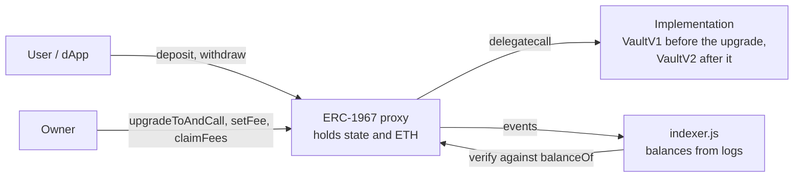

# solidity-proof

[](https://github.com/codenlighten/solidity-proof/actions/workflows/ci.yml)


**Small contracts, tested hard.** An ERC-20, an ERC-721, a UUPS-upgradeable vault and a measured
gas comparison, with Hardhat and Foundry tests, fuzzing and invariants, mutation checks, static
analysis, an event indexer, a browser-tested dApp page and CI.

The contracts are deliberately small. The subject is how they were checked, what that checking found,
and where its limits are. Test results and the automated checks are runnable; the review findings are
recorded, and each was checked against the code before acting on it.

## At a glance

| | |
|---|---|
| Contracts | 4 production (`CappedToken`, `Collectible`, `VaultV1`, `VaultV2`) + a gas pair + test helpers |
| Tests | **40** Hardhat + **15** Foundry (1000-run fuzz, differential fuzz, stateful invariants) |
| Invariant runs | 256 runs × depth 100 = 25,600 handler calls, 0 reverts, against an independent ledger model |
| Coverage | 100% of lines; production contracts 100% of statements (all files 96.3%, 78.6% branches) |
| Mutation checks | 14 deliberate bugs planted in the contracts, one at a time; the suites fail on every one ([docs/TESTING.md](docs/TESTING.md)) |
| Static analysis | Slither 0.11.6 (6 results, each with a disposition); Mythril 0.24.8, time-bounded (MythX itself was not used) |
| CI | 5 jobs on every push: Hardhat tests, Foundry tests, Slither (report only), gitleaks, browser end-to-end. Coverage, Mythril and the mutation runs are manual |
| Not audited | Demonstration code. Do not deploy it with real funds. |

## What the posting asks for, and where it is

| Requirement | Evidence |
|---|---|
| Architect contract systems | [Architecture](#architecture) below; [docs/DECISIONS.md](docs/DECISIONS.md) (16 recorded decisions) |
| Upgradeable code | `VaultV1` → `VaultV2` (UUPS), storage-layout validation, atomic upgrade + reinitializer, a planted incompatible layout the plugin must reject |
| Gas-efficient code | `contracts/gas/`: naive vs optimized, measured at five sizes, with the honest result that it saves 2–3% when every slot is cold and ~14% when slots are warm ([docs/GAS.md](docs/GAS.md)) |
| ERC-20 | `CappedToken`: supply cap, role-gated mint, burn, EIP-2612 permit |
| ERC-721 | `Collectible`: enumerable, EIP-2981 royalties, paid capped mint |
| OpenZeppelin | v5.6.1, pinned exactly; standard and upgradeable packages |
| Hardhat or Foundry | Both: `test/` (ethers v6) and `foundry/test/` |
| Unit and integration tests | Unit per contract; integration across deploy, upgrade, indexer and client; see [docs/TESTING.md](docs/TESTING.md) |
| Slither, MythX | Slither: yes. MythX: not used (hosted service); standalone Mythril was run instead, time-bounded. Results with reasoning in [docs/SECURITY.md](docs/SECURITY.md) |
| Backend integration | `scripts/indexer.js`: rebuilds balances from events, detects reorgs and rebuilds, checked against the chain; deploy and upgrade scripts |
| Front-end dApp integration | `web/`: a tested data layer plus a wallet page, exercised in headless Chrome (`npm run e2e`) |
| Code review | AI-assisted review (an independent model) of the contracts, tests and docs, four passes; each point checked against the code. Findings and fixes below and in [docs/SECURITY.md](docs/SECURITY.md) |
| Document technical decisions | [docs/DECISIONS.md](docs/DECISIONS.md), [docs/GAS.md](docs/GAS.md) |

## Quick start

```bash
npm ci
npm test               # 40 Hardhat tests
npm run test:foundry   # 15 Foundry tests (needs Foundry; forge 1.8.6 used)
npm run coverage
npm run gas            # gas report
npm run slither        # needs Slither 0.11.6 in a Python venv, solc 0.8.28
npm run mythril        # needs Mythril 0.24.8; MYTH_TIMEOUT seconds per contract (default 90)
npm run e2e            # browser test; needs Chrome or Chromium
```

Node 22. Foundry reads OpenZeppelin from `node_modules`, so there is one pinned copy and no vendored
test library (the few cheatcodes the tests use are declared in `foundry/test/Base.sol`).

## Architecture



- **`CappedToken`**: ERC-20 with an immutable cap, a minter role, burn and EIP-2612 permit. Custom
  errors and an `immutable` cap keep it cheap.
- **`Collectible`**: ERC-721 with enumeration, EIP-2981 royalties and a paid mint that is exact-price and
  supply-limited. Proceeds are owner-withdrawn with a checked send.
- **`VaultV1` / `VaultV2`**: an ETH vault behind a UUPS proxy. V2 adds a withdrawal fee (rate capped at 500 bps; the fee rounds up, so splitting a withdrawal never
  pays less than one withdrawal, and a 1 wei withdrawal pays 1 wei), fee accrual and owner claims. The V2
  upgrade and its reinitializer run in one transaction.
- **Events are the interface for off-chain code.** `Withdrawn` reports the gross amount debited and V2
  emits `FeeCharged` separately, so an indexer can rebuild balances exactly.

## What building it found

What the checks caught while building it, found by tests, mutation runs, AI-assisted review and a real
browser, and fixed:

| Found | How | Fix |
|---|---|---|
| V2's fee rounded down, so withdrawing 1 wei at a time paid no fee | AI-assisted review | round up with `Math.mulDiv`; a fuzz test checks that splitting never pays less ([DECISIONS 14](docs/DECISIONS.md)) |
| The invariant suite was partly vacuous: failing handler assertions were swallowed | mutation testing: three planted bugs survived | `fail_on_revert = true`; all three now caught |
| The fee model read its rate from the contract it was testing | AI-assisted review | the handler records the rate it asked for |
| `initializeV2` could be called by anyone after a non-atomic upgrade | AI-assisted review | owner-only, and called inside `upgradeToAndCall` |
| `Withdrawn` mixed net and gross, so indexers would drift | AI-assisted review | gross in `Withdrawn`, fee in `FeeCharged` |
| The dApp page could not load: a bare `"ethers"` import needs an import map | headless Chrome run | import map pinned to the dependency version |
| Wrong-network and no-contract errors showed a generic message | headless Chrome run | `ClientError` carries its own text |
| An optimization claim ("constant ~561 gas/recipient") was not true | AI-assisted review, then measured | measured at 1, 2, 10, 50, 100 recipients; claim rewritten |

## Testing, in one paragraph

Unit and integration tests in Hardhat; fuzz, differential fuzz and stateful invariant tests in Foundry;
a seeded random-sequence conservation check in Hardhat that spans a mid-run V1→V2 upgrade; a planted
reentrancy attacker proven to drain a deliberately vulnerable vault; a planted incompatible storage
layout; and a browser end-to-end run. Then the tests themselves are tested: 14 deliberate bugs are
planted in the contracts and the suites must fail on each. Details and the mutation table:
[docs/TESTING.md](docs/TESTING.md).

## Security notes

Slither and Mythril results, each with a written disposition, are in
[docs/SECURITY.md](docs/SECURITY.md). Short version: the four low-level `.call` findings are the
recommended way to send ETH and are guarded (state and events before the send, `nonReentrant`); the two
loop findings are the intentionally naive gas baseline; Mythril's one note is the EIP-2612 deadline check.

## Limits, stated plainly

- Not audited, and no formal verification. Fuzzing and invariants find bugs; they do not prove absence.
- Mythril ran with a 100 s limit per contract and depth 3: bounded evidence, not a proof.
- The vault assumes no forced ETH (selfdestruct or coinbase payments); with it, the exact-equality
  invariant would not hold.
- `ReentrancyGuardTransient` needs EIP-1153 (Cancun). Target chains must support it.
- The indexer compares the hash of its last indexed block on each sync. Any reorg that replaces an
  indexed block changes that hash, so it is detected, and recovery is a full rebuild from `startBlock`
  (correct but slow on a long chain). Confirmations make this rare. It does not persist across restarts; a
  production service would store balances and its checkpoint atomically.
- The dApp was tested with a mock wallet in headless Chrome, not a real wallet extension, mobile
  layouts or an accessibility audit.
- No mainnet or testnet deployment. Scripts read keys only from an ignored `.env` (`.env.example` lists
  the names); never use a funded mainnet key.

## Repository layout

```
contracts/        CappedToken, Collectible, VaultV1, VaultV2
contracts/gas/    AirdropNaive vs AirdropOptimized
contracts/test/   attacker, vulnerable vault, bad storage layout (test helpers only)
test/             Hardhat tests (unit, integration, conservation, gas)
foundry/test/     Foundry fuzz and invariant tests, Base.sol (cheatcode interface)
scripts/          deploy, upgrade, indexer, e2e runner
web/              vault-client.js, index.html, e2e/ (mock wallet and browser test page)
docs/             DECISIONS, GAS, TESTING, SECURITY, slither.txt
.github/          CI workflow
```

## Versions used

solc 0.8.28 (Cancun) · OpenZeppelin 5.6.1 · Hardhat 2.29.1 · ethers 6.17.0 · Foundry (forge) 1.8.6 ·
Slither 0.11.6 · Mythril 0.24.8 · Node 22.

## About the author

Gregory J. Ward: co-founder and CTO/CDO at SmartLedger Technology since 2020; CompTIA Security+ (2020).
Background in tamper-evident systems and cryptographic integrity: hash chains and Merkle commitments,
blockchain anchoring (BSV), and a protocol for verifiable records of human and AI activity using ML-DSA
signatures. He led the IBM engineering team during the first implementation of CertiHash, a
tamper-evident cybersecurity architecture.

That background is adjacent to Solidity, not Solidity employment history. This repository is the
Solidity evidence. [LinkedIn](https://linkedin.com/in/gregory-ward-032447176) ·
[smartledger.technology](https://smartledger.technology)

## License

MIT, per the SPDX identifier in each source file.
